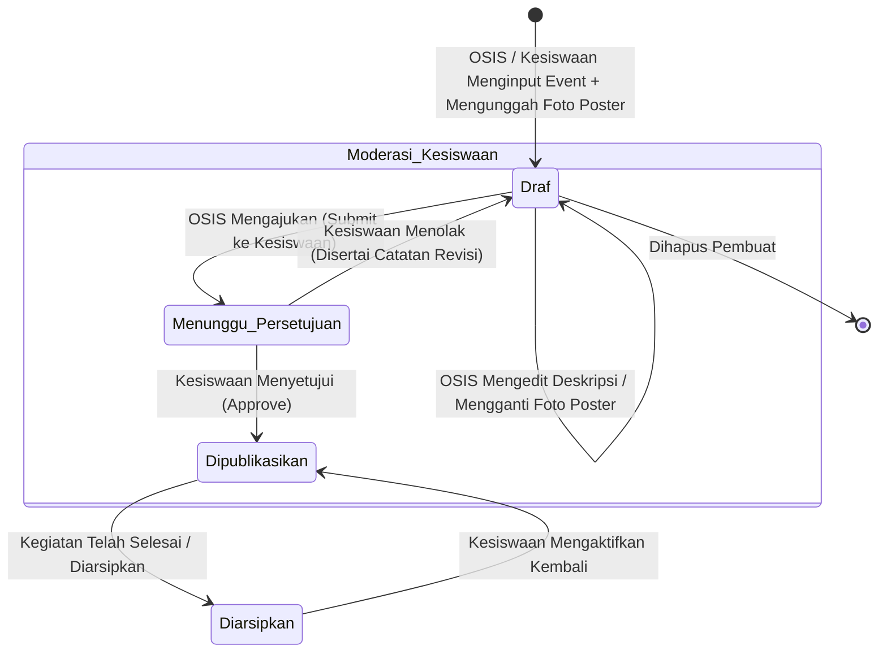
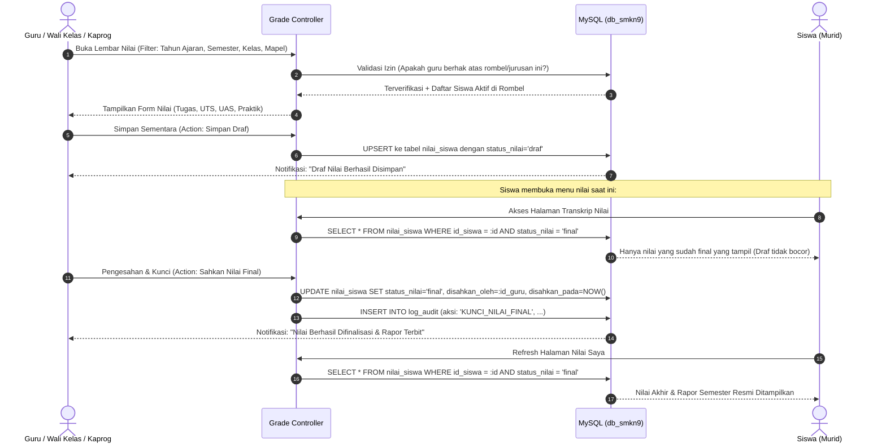
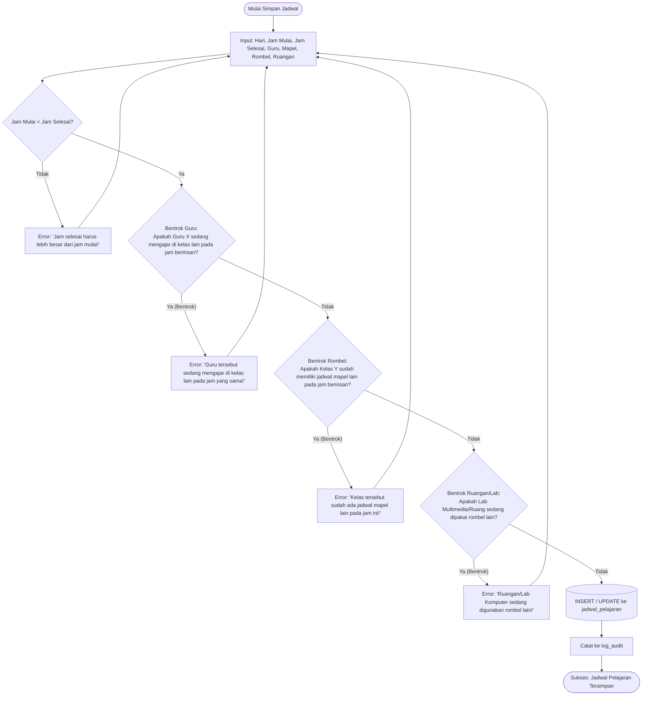
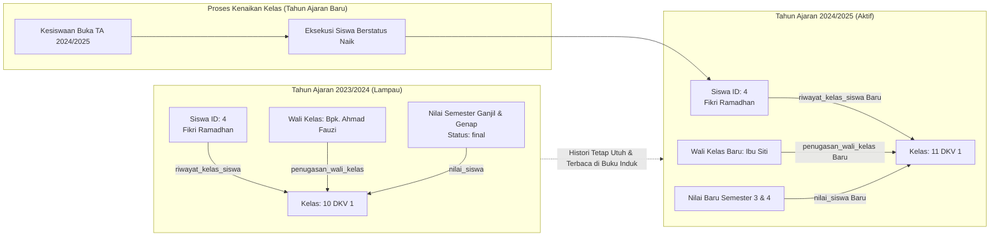

# SPESIFIKASI KEBUTUHAN SISTEM & ALUR KERJA (WORKFLOW)
## SISTEM INFORMASI AKADEMIK (SIAKAD) SMK NEGERI 9 TANGERANG
**Kode Proyek:** `web-komet` | **Database:** `db_smkn9` (Bahasa Indonesia) | **Target Rilis:** Versi 1.0.0

---

## 1. Latar Belakang & Analisis Masalah

SMK Negeri 9 Tangerang sebagai salah satu institusi pendidikan kejuruan unggulan di Kota Tangerang membutuhkan transformasi digital terintegrasi untuk mengelola siklus akademik harian. Selama ini, operasional sekolah kejuruan menghadapi sejumlah tantangan spesifik:
1. **Kompleksitas Kejuruan (Multi-Konsentrasi Keahlian):** SMK memiliki jurusan spesifik seperti Desain Komunikasi Visual (DKV), PPLG/RPL, TJKT/TKJ, dan AKL dengan struktur rombongan belajar bertingkat (contoh: 10 DKV 1, 10 DKV 2, 11 DKV 1, 11 DKV 2, 12 DKV 1, 12 DKV 2). Kepala Program (Kaprog) membutuhkan visibilitas khusus terhadap jurusannya tanpa terganggu data jurusan lain.
2. **Ketergantungan Riwayat Akademik (Academic Historical Continuity):** Setiap pergantian tahun ajaran, siswa berpindah kelas dan wali kelas berganti penugasan. Sistem harus mempertahankan riwayat nilai dan keanggotaan kelas terdahulu tanpa *overwrite* atau duplikasi data melalui tabel `riwayat_kelas_siswa`.
3. **Pemisahan Status Penilaian:** Guru dan wali kelas membutuhkan mekanisme penyimpanan sementara (`draf`) saat menyusun nilai sebelum disahkan (`final`) dan diterbitkan ke rapor siswa di tabel `nilai_siswa`.
4. **Sentralisasi Informasi & Koordinasi OSIS dengan Unggah Foto Poster:** Kegiatan sekolah dan program kesiswaan membutuhkan satu pintu publikasi resmi. Pengurus OSIS dapat membuat usulan event lengkap dengan unggahan foto poster resmi, yang selanjutnya dikurasi melalui pintu persetujuan Kesiswaan (*approval gatekeeper*).

---

## 2. Definisi Persona Pengguna

### Persona 1: Bapak Drs. Hendra (Koordinator Kesiswaan & Guru Bahasa Indonesia)
- **Status Basis Data:** Tercatat di tabel `pengguna` (`id_peran = 1`) dan tabel `guru` (`nip = 19750814...`).
- **Tujuan:** Mengawasi jalannya kegiatan KBM sekolah, menyetujui usulan event OSIS, mengelola jadwal global, dan memverifikasi pengesahan nilai akhir rapor.
- **Pain Points:** Terlalu banyak berkas fisik terpisah; ingin moderasi publikasi event yang transparan dan cepat.

### Persona 2: Ibu Siti Rahmawati, S.Sn. (Kaprog DKV & Guru Kejuruan DKV)
- **Status Basis Data:** Tercatat di tabel `pengguna` (`id_peran = 2`), tabel `guru` (`nip = 19820320...`), dan tabel `jurusan` (`id_guru_kaprog = 2`).
- **Tujuan:** Memonitor jadwal penggunaan lab komputer multimedia DKV, memantau penginputan nilai kejuruan di kelas 10 DKV 1 s/d 12 DKV 2, serta memastikan tidak ada jam praktik yang bentrok.
- **Pain Points:** Guru dari jurusan lain salah melihat jadwal lab; membutuhkan dasbor yang fokus hanya pada rumpun DKV.

### Persona 3: Bapak Ahmad Fauzi, S.Pd. (Wali Kelas 10 DKV 1 & Guru Desain)
- **Status Basis Data:** Tercatat di tabel `pengguna` (`id_peran = 3`), tabel `guru`, dan tabel `penugasan_wali_kelas`.
- **Tujuan:** Mengelola 36 siswa binaannya di kelas 10 DKV 1, memantau nilai tugas/UTS/UAS/praktik, dan mengesahkan rapor kelas binaan.
- **Pain Points:** Tidak ingin terganggu oleh data kelas lain; ingin kemudahan input nilai spreadsheet yang cepat.

### Persona 4: Muhammad Rizky Pratama (Siswa Kelas 10 DKV 1)
- **Status Basis Data:** Tercatat di tabel `pengguna` (`id_peran = 4`) dan tabel `siswa`.
- **Tujuan:** Melihat jadwal pelajaran KBM harian dari smartphone Android/iOS, mengecek nilai rapor yang telah sah (`final`), dan melihat pengumuman serta poster event sekolah terbaru.
- **Pain Points:** Sering terlambat mengetahui info jadwal KBM; ingin melihat mading digital dengan poster kegiatan yang jelas.

### Persona 5: Nayla Zahra (Ketua OSIS SMKN 9 Tangerang)
- **Status Basis Data:** Tercatat di tabel `pengguna` (`id_peran = 5`).
- **Tujuan:** Membuat usulan event, **mengunggah foto poster kegiatan**, dan memantau status persetujuan dari Kesiswaan.
- **Pain Points:** Tidak memiliki wewenang ke data akademik; membutuhkan form pembuatan event dengan fitur upload foto poster berpratinjau (*live preview*).

---

## 3. Matriks Kebutuhan Fungsional (Functional Requirements)

| ID Modul | Kebutuhan Fungsional | Deskripsi | Aktor Utama |
| :--- | :--- | :--- | :--- |
| **FR-AUTH-01** | Otentikasi Multi-Role | Form login aman dengan Bcrypt/Argon2id. Otomatis mengarahkan user ke dasbor sesuai role. | Semua Pengguna |
| **FR-EVT-01** | Pembuatan Draf Event & Upload Foto | OSIS dan Kesiswaan dapat membuat entri event lengkap dengan judul, deskripsi, tanggal, waktu, lokasi, penyelenggara, dan **mengunggah foto poster (JPG, PNG, WebP max 2MB)**. | OSIS, Kesiswaan |
| **FR-EVT-02** | Pengajuan Persetujuan Event | OSIS dapat mengajukan event dari status `draf` ke `menunggu_persetujuan`. | OSIS |
| **FR-EVT-03** | Moderasi & Publikasi Event | Kesiswaan dapat menyetujui (`dipublikasikan`), menolak (kembali ke `draf` beserta catatan alasan revisi), atau mengarsipkan (`diarsipkan`). | Kesiswaan |
| **FR-EVT-04** | Tampilan Mading Siswa | Siswa hanya melihat event berstatus `dipublikasikan`. Foto poster tampil utuh dan dapat diperbesar. | Siswa |
| **FR-GRD-01** | Input Nilai Per Rombel & Mapel | Guru/Wali Kelas menginput nilai Tugas, UTS, UAS, dan Praktik kejuruan. | Wali Kelas, Kaprog, Kesiswaan |
| **FR-GRD-02** | Status Nilai (Draf vs Final) | Nilai dapat disimpan sebagai `draf` (rahasia internal) atau dikunci menjadi `final` (terbit ke siswa). | Wali Kelas, Kaprog, Kesiswaan |
| **FR-GRD-03** | Transkrip Nilai Siswa | Siswa hanya dapat melihat daftar nilai miliknya sendiri untuk nilai yang berstatus `final`. | Siswa |
| **FR-SCH-01** | Jadwal Bebas Bentrok | Validasi komposit mencegah tabrakan jadwal pada dimensi guru, kelas, dan ruangan/lab. | Kaprog, Wali Kelas, Kesiswaan |
| **FR-SCH-02** | Isolasi Tampilan Jadwal | Kaprog melihat jadwal jurusannya, Wali Kelas melihat jadwal kelas binaannya, Siswa melihat jadwal kelasnya. | Kaprog, Wali Kelas, Siswa |
| **FR-STD-01** | Manajemen Profil Siswa | Pengelolaan data induk siswa (NIS, NISN, Jurusan, Kelas Aktif, Biodata). | Kesiswaan |
| **FR-STD-02** | Riwayat Kenaikan Tingkat | Pencatatan kenaikan kelas tahunan melalui tabel `riwayat_kelas_siswa` tanpa menimpa histori tahun lalu. | Kesiswaan |
| **FR-AUD-01** | Pencatatan Jejak Audit | Setiap mutasi nilai final, penugasan wali kelas, dan moderasi event dicatat otomatis ke `log_audit`. | Sistem |

---

## 4. Alur Kerja Sistem (Business Workflows)

### 4.1. Siklus Hidup Event & Unggah Foto Poster OSIS

**Ketentuan Upload Foto Event OSIS:**
1. File yang didukung: JPG, JPEG, PNG, dan WebP (Maksimal 2 MB).
2. Sistem secara otomatis membuat nama file acak unik untuk keamanan (misal: `poster_event_670d8a1e.webp`).
3. Foto poster tersimpan pada folder `public/uploads/event/`.
4. Jika event ditolak oleh Kesiswaan, OSIS dapat mengganti foto poster yang lebih sesuai dan mengajukan ulang.

---

### 4.2. Siklus Penginputan, Validasi, dan Pengesahan Nilai (`draf` $\rightarrow$ `final`)

---

### 4.3. Alur Deteksi Bentrok Jadwal Pelajaran (3 Dimensi)

---

### 4.4. Alur Kenaikan Kelas & Preservasi Riwayat Akademik

