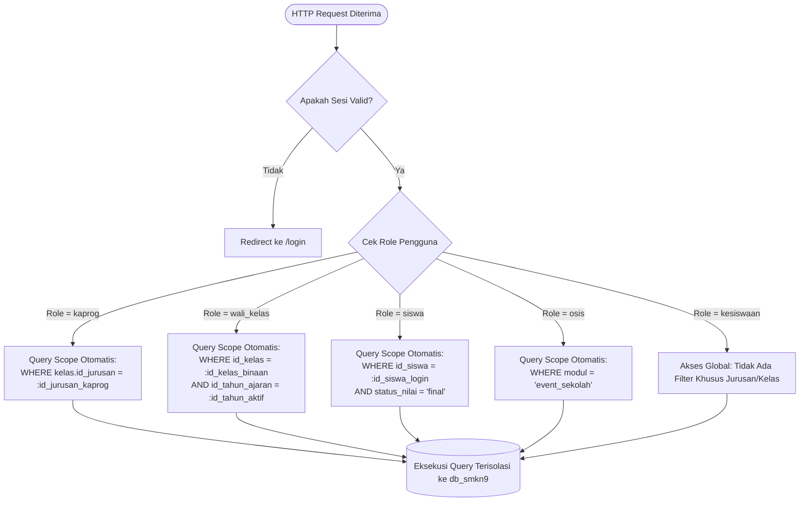

# ARSITEKTUR SISTEM & SPESIFIKASI KEAMANAN
## SISTEM INFORMASI AKADEMIK (SIAKAD) SMK NEGERI 9 TANGERANG
**Kode Proyek:** `web-komet` | **Database:** `db_smkn9` (Bahasa Indonesia)

---

## 1. Arsitektur Perangkat Lunak (Software Architecture)

Untuk memastikan sistem dapat dikembangkan dan dipelihara secara efisien oleh pengembang tunggal (*solo developer*) maupun tim kecil, SIAKAD SMKN 9 Tangerang dirancang menggunakan pola **Clean MVC (Model-View-Controller)** berbasis PHP Native berorientasi objek (OOP) atau framework ringan (seperti Laravel / CodeIgniter 4 / Custom MVC).

Arsitektur ini memisahkan logika presentasi, logika bisnis, dan akses data secara modular:

```
web-komet/
├── app/
│   ├── Controllers/         # Menangani HTTP request, validasi input, dan routing logic
│   │   ├── AuthController.php
│   │   ├── Kesiswaan/       # Dashboard & fitur admin akademik global
│   │   ├── Kaprog/          # Dasbor kejuruan & pengelolaan terisolasi per jurusan
│   │   ├── WaliKelas/       # Dasbor rombel & entri nilai kelas binaan
│   │   ├── Siswa/           # Portal transkrip nilai, jadwal, dan biodata
│   │   └── Osis/            # Dasbor pengajuan event & unggah foto poster
│   ├── Middleware/          # Filter otentikasi & otorisasi sebelum masuk controller
│   │   ├── AuthMiddleware.php
│   │   ├── RoleMiddleware.php
│   │   └── CsrfMiddleware.php
│   ├── Models/              # Objek akses data (Query Builder / PDO Active Record)
│   │   ├── Pengguna.php
│   │   ├── Siswa.php
│   │   ├── Guru.php
│   │   ├── NilaiSiswa.php
│   │   ├── JadwalPelajaran.php
│   │   ├── EventSekolah.php
│   │   └── LogAudit.php
│   ├── Services/            # Logika bisnis kompleks (Conflict Detection, Kalkulasi Nilai)
│   │   ├── ScheduleService.php
│   │   ├── GradeService.php
│   │   └── EventApprovalService.php
│   └── Helpers/             # Fungsi utilitas (Sanitasi, Format Tanggal, Session Helper)
├── config/                  # Konfigurasi database, konstanta sistem, dan session
│   ├── database.php
│   └── app.php
├── docs/                    # Dokumentasi lengkap sistem
├── public/                  # Document root web server (Hanya folder ini yang terbuka ke publik)
│   ├── index.php            # Front Controller tunggal
│   ├── assets/              # File CSS, JS, Fonts
│   └── uploads/             # Direktori upload berkas
│       ├── event/           # Foto poster kegiatan yang diunggah OSIS
│       └── siswa/           # Foto profil siswa
├── views/                   # Template tampilan HTML/PHP terstruktur
│   ├── layouts/             # Template dasar (Sidebar, Navbar, Footer, Mobile Nav)
│   ├── kesiswaan/
│   ├── kaprog/
│   ├── wali_kelas/
│   ├── siswa/
│   └── osis/
└── logs/                    # Berkas log aplikasi & error exceptions
```

---

## 2. Prinsip Isolasi Data di Sisi Server (Server-Side Query Scoping)

Sistem memegang teguh prinsip: **"Keamanan tidak boleh hanya mengandalkan penyembunyian antarmuka (UI Hiding), melainkan wajib ditegakkan hingga lapisan query database."**

Bahkan jika seorang pengguna sengaja mengubah parameter ID di URL (misal: `GET /nilai/detail?id_kelas=5`), middleware dan model akan memverifikasi apakah hak akses pengguna mencakup ID kelas tersebut.

### Matriks Aturan Query Berdasarkan Role:



### Implementasi Logika Query Scope (Contoh Kode Abstraksi):

#### 1. Scope Kaprog (Contoh: Menampilkan Jadwal Jurusan DKV):
```php
public function getDepartmentSchedules(int $idPengguna, int $idTahunAjaran) {
    // 1. Ambil data guru dan jurusan yang diampu kaprog
    $idJurusan = $this->db->query(
        "SELECT id FROM jurusan WHERE id_guru_kaprog = 
         (SELECT id FROM guru WHERE id_pengguna = :id_pengguna LIMIT 1)",
        [':id_pengguna' => $idPengguna]
    )->fetchColumn();

    if (!$idJurusan) {
        throw new UnauthorizedAccessException("Akun Anda tidak terdaftar sebagai Kaprog pada jurusan manapun.");
    }

    // 2. Query jadwal DIBATASI ketat hanya pada kelas dalam jurusannya
    $sql = "SELECT jp.*, k.nama_kelas, mp.nama_mapel, g.nama_lengkap AS nama_guru
            FROM jadwal_pelajaran jp
            JOIN penugasan_guru pg ON jp.id_penugasan_guru = pg.id
            JOIN kelas k ON pg.id_kelas = k.id
            JOIN mata_pelajaran mp ON pg.id_mapel = mp.id
            JOIN guru g ON pg.id_guru = g.id
            WHERE k.id_jurusan = :id_jurusan 
              AND pg.id_tahun_ajaran = :id_tahun_ajaran
            ORDER BY FIELD(jp.hari, 'Senin','Selasa','Rabu','Kamis','Jumat','Sabtu'), jp.jam_mulai";
            
    return $this->db->query($sql, [':id_jurusan' => $idJurusan, ':id_tahun_ajaran' => $idTahunAjaran])->fetchAll();
}
```

#### 2. Scope Wali Kelas (Contoh: Mengambil Daftar Nilai Rombel):
```php
public function getHomeroomStudentGrades(int $idPengguna, int $idKelas, int $idTahunAjaran) {
    // 1. Validasi integritas: Apakah guru ini benar wali kelas resmi dari idKelas di tahun aktif?
    $isAuthorized = $this->db->query(
        "SELECT COUNT(*) FROM penugasan_wali_kelas pwk
         JOIN guru g ON pwk.id_guru = g.id
         WHERE g.id_pengguna = :id_pengguna 
           AND pwk.id_kelas = :id_kelas 
           AND pwk.id_tahun_ajaran = :id_tahun_ajaran 
           AND pwk.apakah_aktif = 1",
        [':id_pengguna' => $idPengguna, ':id_kelas' => $idKelas, ':id_tahun_ajaran' => $idTahunAjaran]
    )->fetchColumn();

    if (!$isAuthorized) {
        // Blokir akses jika mencoba membuka kelas lain!
        http_response_code(403);
        die("Akses Ditolak: Anda bukan wali kelas resmi untuk rombel ini.");
    }

    // 2. Ambil data nilai hanya untuk siswa kelas binaannya
    $sql = "SELECT s.nis, s.nama_lengkap, ns.nilai_tugas, ns.nilai_uts, ns.nilai_uas, ns.nilai_praktik, ns.nilai_akhir, ns.status_nilai
            FROM riwayat_kelas_siswa rks
            JOIN siswa s ON rks.id_siswa = s.id
            LEFT JOIN nilai_siswa ns ON ns.id_siswa = s.id
            WHERE rks.id_kelas = :id_kelas AND rks.id_tahun_ajaran = :id_tahun_ajaran";
    return $this->db->query($sql, [':id_kelas' => $idKelas, ':id_tahun_ajaran' => $idTahunAjaran])->fetchAll();
}
```

#### 3. Scope Siswa (Contoh: Menampilkan Nilai Rapor Pribadi):
```php
public function getStudentSelfGrades(int $idPengguna, int $idSemester) {
    // Siswa HANYA dapat melihat nilainya sendiri dan HANYA yang statusnya 'final'
    $sql = "SELECT mp.nama_mapel, mp.kode_mapel, ns.nilai_tugas, ns.nilai_uts, ns.nilai_uas, ns.nilai_praktik, ns.nilai_akhir, ns.predikat_huruf
            FROM nilai_siswa ns
            JOIN penugasan_guru pg ON ns.id_penugasan_guru = pg.id
            JOIN mata_pelajaran mp ON pg.id_mapel = mp.id
            JOIN siswa s ON ns.id_siswa = s.id
            WHERE s.id_pengguna = :id_pengguna 
              AND ns.id_semester = :id_semester 
              AND ns.status_nilai = 'final'"; // WAJIB 'final'! Nilai 'draf' tidak bocor.
    return $this->db->query($sql, [':id_pengguna' => $idPengguna, ':id_semester' => $idSemester])->fetchAll();
}
```

---

## 3. Spesifikasi Keamanan Siber (Security Architecture)

### 3.1. Penanganan Otentikasi & Enkripsi Kata Sandi
- **Algoritma Hashing:** Menggunakan standar `PASSWORD_BCRYPT` (cost factor 10-12) atau `PASSWORD_ARGON2ID` bawaan PHP. Dilarang keras menggunakan MD5 atau SHA1.
- **Proteksi Brute-Force:** Membatasi percobaan login maksimal 5 kali berturut-turut per alamat IP dan per username. Jika melebihi batas, akun terkunci sementara selama 15 menit.
- **Session Security:**
  - `session.cookie_httponly = 1`: Mencegah script jahat membaca cookies melalui serangan XSS.
  - `session.use_only_cookies = 1`: Mencegah session fixation melalui URL.
  - `session.cookie_samesite = 'Lax'`: Mencegah eksploitasi serangan Cross-Site Request Forgery (CSRF).
  - Panggilan `session_regenerate_id(true)` wajib dijalankan tepat setelah kredensial berhasil diverifikasi.

### 3.2. Pencegahan SQL Injection (SQLi)
- Seluruh interaksi database wajib menggunakan **PDO (PHP Data Objects)** dengan **Prepared Statements** berparameter.
- Penonaktifan *emulated prepared statements* pada konfigurasi PDO:
  ```php
  $pdo->setAttribute(PDO::ATTR_EMULATE_PREPARES, false);
  $pdo->setAttribute(PDO::ATTR_ERRMODE, PDO::ERRMODE_EXCEPTION);
  ```

### 3.3. Pencegahan Cross-Site Scripting (XSS) & Pengamanan Upload Foto OSIS
- Seluruh output teks dinamis yang dirender ke tampilan wajib di-escape menggunakan helper function berbasis `htmlspecialchars($str, ENT_QUOTES, 'UTF-8')`.
- **Pengamanan Upload Foto Poster Event (OSIS) & Pasfoto Siswa:**
  - Validasi tipe MIME riil berkas menggunakan `mime_content_type()` (bukan sekadar membaca ekstensi file).
  - Pembatasan ekstensi hanya diperbolehkan `.jpg`, `.jpeg`, `.png`, dan `.webp`.
  - Mengubah nama file secara acak (*sanitized unique slug*, contoh: `poster_event_670d8a1e4b11.webp`) untuk mencegah *remote code execution* melalui berkas berbahaya (seperti `shell.php.jpg`).
  - Batas ukuran upload maksimal: 2 MB untuk poster event OSIS, 1 MB untuk foto profil siswa.
  - Penyimpanan berkas diletakkan di `public/uploads/event/`.

### 3.4. Pencegahan Cross-Site Request Forgery (CSRF)
- Setiap form HTML yang melakukan mutasi data (POST, PUT, DELETE) wajib menyertakan token CSRF kriptografis acak yang disimpan di sesi pengguna:
  ```html
  <input type="hidden" name="csrf_token" value="<?= htmlspecialchars($_SESSION['csrf_token']) ?>">
  ```
- Token diverifikasi di `CsrfMiddleware` sebelum data diteruskan ke controller.

---

## 4. Mekanisme Audit Logging (Pencatatan Jejak Aktivitas ke `log_audit`)

Untuk menjamin akuntabilitas terhadap perubahan nilai, jadwal, dan keputusan approval event, sistem mengimplementasikan pencatatan audit log otomatis ke tabel `log_audit`.

### Skema Logika Audit Service:
```php
class AuditLogger {
    public static function catat(PDO $db, ?int $idPengguna, string $aksi, string $modul, ?int $idData = null, ?array $dataLama = null, ?array $dataBaru = null) {
        $stmt = $db->prepare("
            INSERT INTO log_audit (id_pengguna, aksi, modul, id_data, nilai_lama, nilai_baru, alamat_ip, agen_pengguna, dibuat_pada)
            VALUES (:id_pengguna, :aksi, :modul, :id_data, :nilai_lama, :nilai_baru, :alamat_ip, :agen_pengguna, NOW())
        ");
        $stmt->execute([
            ':id_pengguna'  => $idPengguna,
            ':aksi'         => $aksi,        // e.g., 'KUNCI_NILAI_FINAL', 'SETUJUI_EVENT'
            ':modul'        => $modul,       // e.g., 'nilai_siswa', 'event_sekolah'
            ':id_data'      => $idData,
            ':nilai_lama'   => $dataLama ? json_encode($dataLama) : null,
            ':nilai_baru'   => $dataBaru ? json_encode($dataBaru) : null,
            ':alamat_ip'    => $_SERVER['REMOTE_ADDR'] ?? '0.0.0.0',
            ':agen_pengguna'=> substr($_SERVER['HTTP_USER_AGENT'] ?? 'Unknown', 0, 255)
        ]);
    }
}
```
Mekanisme ini memungkinkan pihak sekolah menelusuri secara forensik siapa yang mengubah nilai siswa, pada jam berapa, dari angka berapa menjadi berapa, serta dari perangkat mana.
