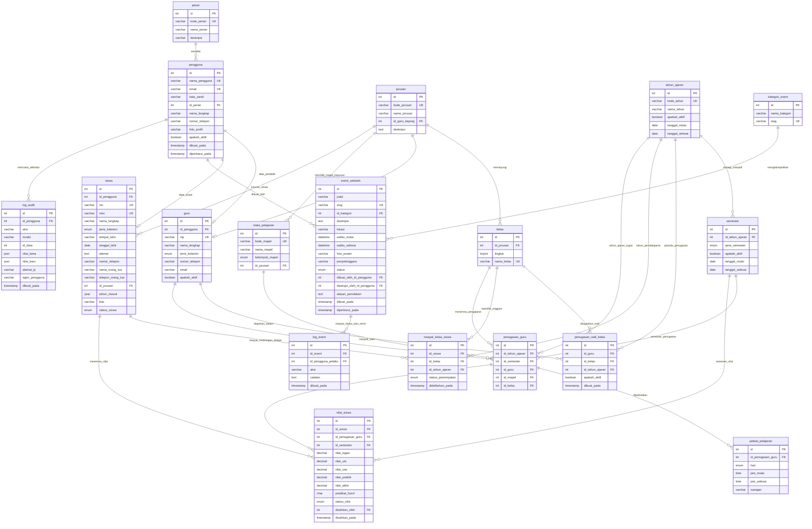

# PERANCANGAN BASIS DATA & ENTITY RELATIONSHIP DIAGRAM (ERD)
## SISTEM INFORMASI AKADEMIK (SIAKAD) SMK NEGERI 9 TANGERANG
**Kode Proyek:** `web-komet` | **Nama Database:** `db_smkn9` | **Standar Bahasa:** Bahasa Indonesia | **Engine:** MySQL InnoDB

---

## 1. Jawaban Arsitektur Basis Data Penting

### A. Apakah OSIS Dapat Mengunggah Foto Saat Membuat Event?
**YA, TENTU BISA.**
Pada tabel `event_sekolah`, terdapat kolom `foto_poster VARCHAR(255)`. 
- Ketika pengurus OSIS menyusun proposal event melalui antarmuka dasbor OSIS, formulir menyediakan input berkas (*file upload*) bertipe gambar (`.jpg`, `.jpeg`, `.png`, `.webp` dengan batas ukuran maksimal 2MB).
- Berkas gambar disimpan di direktori server `web-komet/public/uploads/event/`, dan nama berkas acak disimpan di kolom `foto_poster`.
- Foto ini langsung memiliki fitur *live preview* saat OSIS mengunggahnya, dan akan tampil sebagai banner utama pada mading digital serta jadwal kegiatan siswa setelah disetujui oleh Kesiswaan.

### B. Apakah Role Kesiswaan dan Kaprog Masuk ke Tabel Guru?
**YA, KEDUANYA TERCATAT DI TABEL `guru`.**
Di lingkungan Sekolah Menengah Kejuruan (SMK):
1. **Kesiswaan** (biasanya Wakil Kepala Sekolah Bidang Kesiswaan atau Staf Kesiswaan) secara struktural kepegawaian adalah **seorang guru** yang memiliki NIP dan tetap mengampu jam pelajaran (contoh: Drs. Hendra Permana, M.Pd. yang juga mengajar Bahasa Indonesia).
2. **Kaprog** (Kepala Program Keahlian / Kepala Jurusan) adalah **guru kejuruan senior** yang ditugaskan memimpin konsentrasi keahlian tertentu (contoh: Ibu Siti Rahmawati, S.Sn. yang memimpin jurusan DKV dan mengajar Fotografi/Ilustrasi).
3. **Wali Kelas** juga adalah **guru** yang diberi SK penugasan membina satu rombongan belajar.

**Model Relasi Arsitekturnya:**
- Kredensial login disimpan di tabel `pengguna` (`id_peran = 1` untuk kesiswaan, `id_peran = 2` untuk kaprog, `id_peran = 3` untuk wali kelas).
- Biodata resmi pendidik (NIP, Nama Lengkap, Gelar, Kontak) disimpan di tabel `guru` dan terhubung melalui `guru.id_pengguna = pengguna.id`.
- Kepemimpinan jurusan diikat di tabel `jurusan.id_guru_kaprog` yang merujuk langsung ke `guru.id`.
Dengan desain ini, integritas kepegawaian sekolah tetap terjaga tanpa duplikasi data.

---

## 2. Entity Relationship Diagram (ERD Bahasa Indonesia)

---

## 3. Kamus Data Lengkap (Data Dictionary Bahasa Indonesia)

Berikut adalah rincian 18 tabel pada basis data `db_smkn9`:

### 3.1. Tabel `peran`
- **Fungsi:** Menyimpan daftar tingkatan hak akses pengguna.
- **Relasi:** 1:N ke `pengguna.id_peran`.

| Kolom | Tipe Data | Null | Default | Keterangan & Aturan |
| :--- | :--- | :--- | :--- | :--- |
| `id` | INT AUTO_INCREMENT | NO | - | Primary Key |
| `kode_peran` | VARCHAR(30) | NO | - | UNIQUE (`kesiswaan`, `kaprog`, `wali_kelas`, `siswa`, `osis`) |
| `nama_peran` | VARCHAR(50) | NO | - | Nama gelar tampilan hak akses |
| `deskripsi` | VARCHAR(255) | YES | NULL | Penjelasan wewenang |

---

### 3.2. Tabel `pengguna`
- **Fungsi:** Akun login seluruh sivitas akademika SMKN 9 Tangerang.
- **Relasi:** N:1 ke `peran`, 1:1 ke `guru`, 1:1 ke `siswa`.

| Kolom | Tipe Data | Null | Default | Keterangan & Aturan |
| :--- | :--- | :--- | :--- | :--- |
| `id` | INT AUTO_INCREMENT | NO | - | Primary Key |
| `nama_pengguna` | VARCHAR(50) | NO | - | UNIQUE. Username untuk login |
| `email` | VARCHAR(100) | NO | - | UNIQUE. Email resmi |
| `kata_sandi` | VARCHAR(255) | NO | - | Hash Bcrypt / Argon2id aman |
| `id_peran` | INT | NO | - | FK -> `peran(id)` |
| `nama_lengkap` | VARCHAR(100) | NO | - | Nama lengkap pemilik akun |
| `nomor_telepon` | VARCHAR(20) | YES | NULL | Nomor kontak WhatsApp |
| `foto_profil` | VARCHAR(255) | YES | 'avatar_default.png' | Path avatar |
| `apakah_aktif` | TINYINT(1) | NO | 1 | 1 = Aktif, 0 = Nonaktif |
| `dibuat_pada` | TIMESTAMP | NO | CURRENT_TIMESTAMP | Tanggal pembuatan |
| `diperbarui_pada`| TIMESTAMP | NO | CURRENT_TIMESTAMP | Otomatis terupdate |

---

### 3.3. Tabel `guru`
- **Fungsi:** Master profil kepegawaian tenaga pendidik (Mencakup Guru, Kesiswaan, Kaprog, dan Wali Kelas).
- **Relasi:** 1:1 ke `pengguna`, 1:N ke `penugasan_wali_kelas`, 1:N ke `penugasan_guru`.

| Kolom | Tipe Data | Null | Default | Keterangan & Aturan |
| :--- | :--- | :--- | :--- | :--- |
| `id` | INT AUTO_INCREMENT | NO | - | Primary Key |
| `id_pengguna` | INT | YES | NULL | UNIQUE, FK -> `pengguna(id)` |
| `nip` | VARCHAR(30) | YES | NULL | UNIQUE untuk PNS, NULL untuk honorer |
| `nama_lengkap` | VARCHAR(100) | NO | - | Nama guru beserta gelar resmi |
| `jenis_kelamin` | ENUM('L','P') | NO | 'L' | L = Laki-laki, P = Perempuan |
| `nomor_telepon` | VARCHAR(20) | YES | NULL | Kontak darurat guru |
| `email` | VARCHAR(100) | YES | NULL | Email dinas guru |
| `apakah_aktif` | TINYINT(1) | NO | 1 | 1 = Aktif mengajar, 0 = Purnabakti |

---

### 3.4. Tabel `jurusan` (Konsentrasi Keahlian)
- **Fungsi:** Menyimpan jurusan kejuruan resmi di SMKN 9 Tangerang (DKV, PPLG, TJKT, AKL).
- **Relasi:** 1:1 ke `guru` (sebagai Kaprog), 1:N ke `kelas`, 1:N ke `siswa`.

| Kolom | Tipe Data | Null | Default | Keterangan & Aturan |
| :--- | :--- | :--- | :--- | :--- |
| `id` | INT AUTO_INCREMENT | NO | - | Primary Key |
| `kode_jurusan` | VARCHAR(20) | NO | - | UNIQUE (`DKV`, `PPLG`, `TJKT`, `AKL`) |
| `nama_jurusan` | VARCHAR(100) | NO | - | Nama lengkap keahlian |
| `id_guru_kaprog`| INT | YES | NULL | FK -> `guru(id)` (Kaprog yang memimpin) |
| `deskripsi` | TEXT | YES | NULL | Profil dan kompetensi lulusan |

---

### 3.5. Tabel `tahun_ajaran`
- **Fungsi:** Menandai kalender siklus pendidikan tahunan.
- **Relasi:** 1:N ke `semester`, 1:N ke `penugasan_wali_kelas`, 1:N ke `riwayat_kelas_siswa`.

| Kolom | Tipe Data | Null | Default | Keterangan & Aturan |
| :--- | :--- | :--- | :--- | :--- |
| `id` | INT AUTO_INCREMENT | NO | - | Primary Key |
| `kode_tahun` | VARCHAR(15) | NO | - | UNIQUE (Contoh: `2024-2025`) |
| `nama_tahun` | VARCHAR(30) | NO | - | Contoh: 'Tahun Ajaran 2024/2025' |
| `apakah_aktif` | TINYINT(1) | NO | 0 | 1 = Tahun ajaran aktif saat ini |
| `tanggal_mulai`| DATE | NO | - | Tanggal awal tahun ajaran |
| `tanggal_selesai`| DATE | NO | - | Tanggal akhir tahun ajaran |

---

### 3.6. Tabel `semester`
- **Fungsi:** Pembagian semester ganjil dan genap dalam satu tahun ajaran.

| Kolom | Tipe Data | Null | Default | Keterangan & Aturan |
| :--- | :--- | :--- | :--- | :--- |
| `id` | INT AUTO_INCREMENT | NO | - | Primary Key |
| `id_tahun_ajaran`| INT | NO | - | FK -> `tahun_ajaran(id)` |
| `jenis_semester`| ENUM('ganjil','genap')| NO | - | Periode belajar |
| `apakah_aktif` | TINYINT(1) | NO | 0 | 1 = Semester yang sedang berlangsung |
| `tanggal_mulai`| DATE | NO | - | Tanggal awal semester |
| `tanggal_selesai`| DATE | NO | - | Tanggal akhir semester |

---

### 3.7. Tabel `kelas` (Rombongan Belajar)
- **Fungsi:** Entitas rombel (10 DKV 1, 10 DKV 2, 11 DKV 1, 11 DKV 2, 12 DKV 1, 12 DKV 2).

| Kolom | Tipe Data | Null | Default | Keterangan & Aturan |
| :--- | :--- | :--- | :--- | :--- |
| `id` | INT AUTO_INCREMENT | NO | - | Primary Key |
| `id_jurusan` | INT | NO | - | FK -> `jurusan(id)` |
| `tingkat` | TINYINT | NO | - | Tingkat: 10, 11, atau 12 |
| `nama_kelas` | VARCHAR(50) | NO | - | UNIQUE. Nama rombel (e.g., '10 DKV 1') |

---

### 3.8. Tabel `penugasan_wali_kelas`
- **Fungsi:** Menyimpan riwayat penugasan guru sebagai wali kelas per tahun ajaran.
- **Constraint Unik:** `UNIQUE (id_kelas, id_tahun_ajaran)` -> 1 kelas hanya punya 1 wali per tahun ajaran.

| Kolom | Tipe Data | Null | Default | Keterangan & Aturan |
| :--- | :--- | :--- | :--- | :--- |
| `id` | INT AUTO_INCREMENT | NO | - | Primary Key |
| `id_guru` | INT | NO | - | FK -> `guru(id)` |
| `id_kelas` | INT | NO | - | FK -> `kelas(id)` |
| `id_tahun_ajaran`| INT | NO | - | FK -> `tahun_ajaran(id)` |
| `apakah_aktif` | TINYINT(1) | NO | 1 | Status aktif SK penugasan |
| `dibuat_pada` | TIMESTAMP | NO | CURRENT_TIMESTAMP | Waktu penetapan SK |

---

### 3.9. Tabel `siswa` (Master Biodata Siswa)
- **Fungsi:** Master profil permanen siswa SMKN 9 Tangerang.

| Kolom | Tipe Data | Null | Default | Keterangan & Aturan |
| :--- | :--- | :--- | :--- | :--- |
| `id` | INT AUTO_INCREMENT | NO | - | Primary Key |
| `id_pengguna` | INT | YES | NULL | UNIQUE, FK -> `pengguna(id)` |
| `nis` | VARCHAR(20) | NO | - | UNIQUE Nomor Induk Siswa |
| `nisn` | VARCHAR(20) | YES | NULL | UNIQUE Nomor Induk Siswa Nasional |
| `nama_lengkap` | VARCHAR(100) | NO | - | Nama siswa sesuai ijazah SMP |
| `jenis_kelamin` | ENUM('L','P') | NO | 'L' | L = Laki-laki, P = Perempuan |
| `tempat_lahir` | VARCHAR(50) | YES | NULL | Tempat lahir |
| `tanggal_lahir`| DATE | YES | NULL | Tanggal lahir |
| `alamat` | TEXT | YES | NULL | Alamat tempat tinggal siswa |
| `nomor_telepon`| VARCHAR(20) | YES | NULL | Nomor kontak WA siswa |
| `nama_orang_tua`| VARCHAR(100) | YES | NULL | Nama ayah/ibu/wali murid |
| `telepon_orang_tua`| VARCHAR(20)| YES | NULL | Kontak darurat orang tua |
| `id_jurusan` | INT | NO | - | FK -> `jurusan(id)` |
| `tahun_masuk` | YEAR | NO | - | Tahun pendaftaran angkatan |
| `foto` | VARCHAR(255) | YES | 'foto_siswa_default.png' | Pasfoto resmi |
| `status_siswa` | ENUM('aktif','lulus','mutasi','keluar') | NO | 'aktif' | Status kesiswaan saat ini |

---

### 3.10. Tabel `riwayat_kelas_siswa`
- **Fungsi:** Menghubungkan siswa dengan rombel pada setiap tahun ajaran. Menjamin siswa yang naik dari 10 DKV 1 ke 11 DKV 1 tidak kehilangan catatan kelas lamanya.
- **Constraint Unik:** `UNIQUE (id_siswa, id_tahun_ajaran)` -> 1 siswa hanya terdaftar di 1 kelas pada tahun ajaran yang sama.

| Kolom | Tipe Data | Null | Default | Keterangan & Aturan |
| :--- | :--- | :--- | :--- | :--- |
| `id` | INT AUTO_INCREMENT | NO | - | Primary Key |
| `id_siswa` | INT | NO | - | FK -> `siswa(id)` |
| `id_kelas` | INT | NO | - | FK -> `kelas(id)` |
| `id_tahun_ajaran`| INT | NO | - | FK -> `tahun_ajaran(id)` |
| `status_penempatan`| ENUM('aktif','naik','tinggal','lulus','pindah') | NO | 'aktif' | Status kenaikan tingkat |
| `didaftarkan_pada`| TIMESTAMP | NO | CURRENT_TIMESTAMP | Waktu registrasi rombel |

---

### 3.11. Tabel `mata_pelajaran`
- **Fungsi:** Katalog mapel umum dan kejuruan.

| Kolom | Tipe Data | Null | Default | Keterangan & Aturan |
| :--- | :--- | :--- | :--- | :--- |
| `id` | INT AUTO_INCREMENT | NO | - | Primary Key |
| `kode_mapel` | VARCHAR(20) | NO | - | UNIQUE kode mata pelajaran |
| `nama_mapel` | VARCHAR(100) | NO | - | Nama mata pelajaran |
| `kelompok_mapel`| ENUM('umum','kejuruan','muatan_lokal') | NO | 'umum' | Klasifikasi kurikulum |
| `id_jurusan` | INT | YES | NULL | FK -> `jurusan(id)` (NULL untuk mapel umum) |

---

### 3.12. Tabel `penugasan_guru`
- **Fungsi:** Surat tugas guru mengajar mata pelajaran tertentu di kelas tertentu per semester.
- **Constraint Unik:** `UNIQUE (id_tahun_ajaran, id_semester, id_guru, id_mapel, id_kelas)`

| Kolom | Tipe Data | Null | Default | Keterangan & Aturan |
| :--- | :--- | :--- | :--- | :--- |
| `id` | INT AUTO_INCREMENT | NO | - | Primary Key |
| `id_tahun_ajaran`| INT | NO | - | FK -> `tahun_ajaran(id)` |
| `id_semester` | INT | NO | - | FK -> `semester(id)` |
| `id_guru` | INT | NO | - | FK -> `guru(id)` |
| `id_mapel` | INT | NO | - | FK -> `mata_pelajaran(id)` |
| `id_kelas` | INT | NO | - | FK -> `kelas(id)` |

---

### 3.13. Tabel `jadwal_pelajaran`
- **Fungsi:** Jam pelaksanaan KBM mingguan.
- **Indeks:** `idx_waktu_jadwal (hari, jam_mulai, jam_selesai)` untuk deteksi bentrok cepat.

| Kolom | Tipe Data | Null | Default | Keterangan & Aturan |
| :--- | :--- | :--- | :--- | :--- |
| `id` | INT AUTO_INCREMENT | NO | - | Primary Key |
| `id_penugasan_guru`| INT | NO | - | FK -> `penugasan_guru(id)` |
| `hari` | ENUM('Senin','Selasa','Rabu','Kamis','Jumat','Sabtu') | NO | - | Hari KBM |
| `jam_mulai` | TIME | NO | - | Waktu mulai |
| `jam_selesai` | TIME | NO | - | Waktu selesai |
| `ruangan` | VARCHAR(50) | NO | 'Ruang Kelas Teori' | Ruang kelas atau Lab Multimedia/Desain |

---

### 3.14. Tabel `nilai_siswa`
- **Fungsi:** Penilaian akademik siswa dengan status `draf` (internal guru) dan `final` (terbit ke rapor siswa).
- **Constraint Unik:** `UNIQUE (id_siswa, id_penugasan_guru, id_semester)`

| Kolom | Tipe Data | Null | Default | Keterangan & Aturan |
| :--- | :--- | :--- | :--- | :--- |
| `id` | INT AUTO_INCREMENT | NO | - | Primary Key |
| `id_siswa` | INT | NO | - | FK -> `siswa(id)` |
| `id_penugasan_guru`| INT | NO | - | FK -> `penugasan_guru(id)` |
| `id_semester` | INT | NO | - | FK -> `semester(id)` |
| `nilai_tugas` | DECIMAL(5,2) | YES | 0.00 | Bobot formatif tugas |
| `nilai_uts` | DECIMAL(5,2) | YES | 0.00 | Ujian Tengah Semester |
| `nilai_uas` | DECIMAL(5,2) | YES | 0.00 | Ujian Akhir Semester |
| `nilai_praktik`| DECIMAL(5,2) | YES | 0.00 | Uji kinerja kejuruan SMK |
| `nilai_akhir` | DECIMAL(5,2) | YES | 0.00 | Nilai komposit akhir |
| `predikat_huruf`| CHAR(2) | YES | 'E' | Predikat mutu (A, B, C, D, E) |
| `status_nilai` | ENUM('draf','final') | NO | 'draf' | draf = rahasia guru, final = terbit ke siswa |
| `disahkan_oleh`| INT | YES | NULL | FK -> `guru(id)` |
| `disahkan_pada`| TIMESTAMP | YES | NULL | Waktu nilai dikunci |
| `diperbarui_pada`| TIMESTAMP | NO | CURRENT_TIMESTAMP | Riwayat edit |

---

### 3.15. Tabel `kategori_event`
- **Fungsi:** Pengelompokan jenis agenda kegiatan sekolah.

| Kolom | Tipe Data | Null | Default | Keterangan & Aturan |
| :--- | :--- | :--- | :--- | :--- |
| `id` | INT AUTO_INCREMENT | NO | - | Primary Key |
| `nama_kategori`| VARCHAR(50) | NO | - | Contoh: 'Lomba & Kejuaraan' |
| `slug` | VARCHAR(50) | NO | - | UNIQUE string ramah URL |

---

### 3.16. Tabel `event_sekolah`
- **Fungsi:** Mading digital dan publikasi kegiatan dengan unggah foto poster resmi oleh OSIS/Kesiswaan.
- **Relasi:** N:1 ke `kategori_event`, N:1 ke `pengguna` (pembuat), N:1 ke `pengguna` (penyetuju).

| Kolom | Tipe Data | Null | Default | Keterangan & Aturan |
| :--- | :--- | :--- | :--- | :--- |
| `id` | INT AUTO_INCREMENT | NO | - | Primary Key |
| `judul` | VARCHAR(150) | NO | - | Judul acara / kegiatan |
| `slug` | VARCHAR(180) | NO | - | UNIQUE URL slug |
| `id_kategori` | INT | NO | - | FK -> `kategori_event(id)` |
| `deskripsi` | LONGTEXT | NO | - | Rincian kegiatan & rundown |
| `lokasi` | VARCHAR(100) | NO | 'SMKN 9 Tangerang' | Tempat pelaksanaan |
| `waktu_mulai` | DATETIME | NO | - | Waktu mulai acara |
| `waktu_selesai`| DATETIME | NO | - | Waktu selesai acara |
| `foto_poster` | VARCHAR(255) | YES | NULL | Berkas upload gambar poster acara dari OSIS |
| `penyelenggara`| VARCHAR(100) | NO | 'OSIS SMKN 9 Tangerang' | Penanggung jawab acara |
| `status` | ENUM('draf','menunggu_persetujuan','dipublikasikan','diarsipkan') | NO | 'draf' | Status moderasi kesiswaan |
| `dibuat_oleh_id_pengguna`| INT | NO | - | FK -> `pengguna(id)` (Akun OSIS/Kesiswaan) |
| `disetujui_oleh_id_pengguna`| INT| YES | NULL | FK -> `pengguna(id)` (Akun Kesiswaan) |
| `disetujui_pada`| TIMESTAMP | YES | NULL | Waktu disetujui terbit |
| `alasan_penolakan`| TEXT | YES | NULL | Catatan revisi jika ditolak Kesiswaan |
| `dibuat_pada` | TIMESTAMP | NO | CURRENT_TIMESTAMP | Waktu entri |
| `diperbarui_pada`| TIMESTAMP | NO | CURRENT_TIMESTAMP | Waktu modifikasi |

---

### 3.17. Tabel `log_event`
- **Fungsi:** Riwayat transparansi transisi status usulan acara dari OSIS ke Kesiswaan.

| Kolom | Tipe Data | Null | Default | Keterangan & Aturan |
| :--- | :--- | :--- | :--- | :--- |
| `id` | INT AUTO_INCREMENT | NO | - | Primary Key |
| `id_event` | INT | NO | - | FK -> `event_sekolah(id)` |
| `id_pengguna_pelaku`| INT | NO | - | FK -> `pengguna(id)` |
| `aksi` | VARCHAR(50) | NO | - | `BUAT_DRAF`, `DIAJUKAN`, `DISETUJUI`, `DITOLAK` |
| `catatan` | TEXT | YES | NULL | Catatan dari pengurus OSIS atau Kesiswaan |
| `dibuat_pada` | TIMESTAMP | NO | CURRENT_TIMESTAMP | Waktu transisi |

---

### 3.18. Tabel `log_audit`
- **Fungsi:** Pencatatan forensik mutasi data penting sistem (Nilai Final, Perubahan Jadwal, Penugasan Wali).

| Kolom | Tipe Data | Null | Default | Keterangan & Aturan |
| :--- | :--- | :--- | :--- | :--- |
| `id` | BIGINT AUTO_INCREMENT | NO | - | Primary Key |
| `id_pengguna` | INT | YES | NULL | FK -> `pengguna(id)` |
| `aksi` | VARCHAR(50) | NO | - | Contoh: `KUNCI_NILAI_FINAL` |
| `modul` | VARCHAR(50) | NO | - | Contoh: `nilai_siswa` |
| `id_data` | INT | YES | NULL | ID baris yang dimutasi |
| `nilai_lama` | JSON | YES | NULL | Snapshot nilai sebelum diubah |
| `nilai_baru` | JSON | YES | NULL | Snapshot nilai sesudah diubah |
| `alamat_ip` | VARCHAR(45) | NO | '0.0.0.0' | IP address pengguna |
| `agen_pengguna`| VARCHAR(255)| YES | NULL | Browser/OS user agent |
| `dibuat_pada` | TIMESTAMP | NO | CURRENT_TIMESTAMP | Waktu pencatatan |
