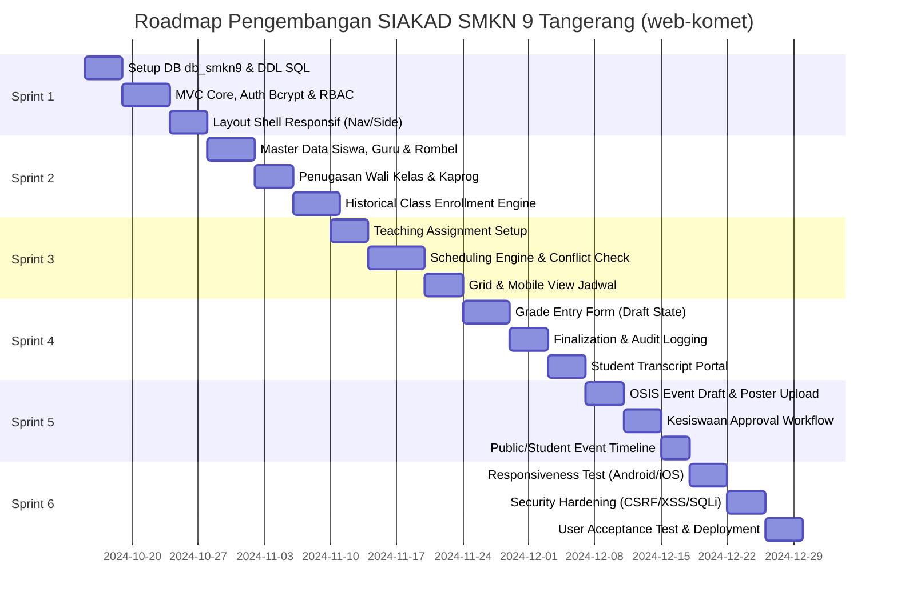

# ROADMAP MANAJEMEN PROYEK & RENCANA PENGEMBANGAN (WBS)
## SISTEM INFORMASI AKADEMIK (SIAKAD) SMK NEGERI 9 TANGERANG
**Kode Proyek:** `web-komet` | **Database:** `db_smkn9` | **Metodologi:** Agile Incremental (6 Sprint)

---

## 1. Work Breakdown Structure (WBS)

Untuk memudahkan eksekusi oleh satu pengembang (*solo developer*) atau tim pengembang kecil, proyek dibagi menjadi 6 komponen kerja utama:

```
PROYEK SIAKAD SMKN 9 TANGERANG (web-komet)
│
├── 1.0 INISIALISASI & BASIS DATA
│   ├── 1.1 Pembuatan skema database db_smkn9 di phpMyAdmin
│   ├── 1.2 Eksekusi DDL & Foreign Key Constraints
│   ├── 1.3 Seeding data master jurusan (DKV, PPLG, TJKT, AKL) & akun awal
│   └── 1.4 Konfigurasi koneksi PDO aman & helper environment
│
├── 2.0 ARSITEKTUR CORE & OTENTIKASI (RBAC)
│   ├── 2.1 Front controller, routing engine, & autoloader
│   ├── 2.2 Form Login dengan hashing Bcrypt & proteksi Brute Force
│   ├── 2.3 Middleware Otentikasi & Guard RBAC (5 Role)
│   └── 2.4 Layout Shell Responsif (Sidebar, Navbar, Mobile Drawer)
│
├── 3.0 MODUL DATA INDUK & HISTORI AKADEMIK
│   ├── 3.1 Manajemen data guru, NIP, & akun
│   ├── 3.2 Manajemen rombel (10 DKV 1 s/d 12 DKV 2) & penugasan wali kelas
│   ├── 3.3 Manajemen biodata siswa (NIS, NISN, foto, kontak)
│   └── 3.4 Logika kenaikan rombel tahunan via class_enrollments
│
├── 4.0 MODUL JADWAL PELAJARAN (ANTI-BENTROK)
│   ├── 4.1 Modul penugasan guru mengajar (teaching_assignments)
│   ├── 4.2 Form input jadwal mingguan per kelas
│   ├── 4.3 Service validasi bentrok (Cek Guru, Cek Kelas, Cek Lab/Ruang)
│   └── 4.4 Tampilan jadwal terisolasi (Kaprog, Wali Kelas, Siswa)
│
├── 5.0 MODUL NILAI AKADEMIK (DRAFT / FINAL)
│   ├── 5.1 Spreadsheet-like interface untuk input nilai tugas/UTS/UAS/praktik
│   ├── 5.2 Mekanisme simpan draft (terisolasi dari siswa)
│   ├── 5.3 Aksi kunci nilai final & pencatatan audit log
│   └── 5.4 Portal transkrip rapor digital siswa (Read-only)
│
└── 6.0 MODUL EVENT SEKOLAH & APPROVAL OSIS
    ├── 6.1 Form draf event OSIS & unggah poster
    ├── 6.2 Alur pengajuan persetujuan (Status: draft -> pending)
    ├── 6.3 Moderasi & publikasi kesiswaan (Status: published / rejected)
    └── 6.4 Tampilan mading digital & arsip event
```

---

## 2. Rencana Pengembangan Bertahap (Sprint Roadmap)

Setiap sprint dirancang berdurasi 1 hingga 2 minggu dengan target *deliverable* yang dapat diuji (*testable working software*):



### Rincian Target Tiap Sprint:
- **Sprint 1 (Fondasi & Keamanan):**
  - Database `db_smkn9` siap di phpMyAdmin beserta seluruh tabel dan foreign key.
  - Sesi login 5 role berjalan lancar. Routing otomatis mengarahkan Kesiswaan, Kaprog, Wali Kelas, Siswa, dan OSIS ke dasbor masing-masing.
- **Sprint 2 (Data Akademik & Sejarah):**
  - CRUD Data Siswa dan Guru.
  - Pengujian kenaikan kelas siswa dari 10 DKV ke 11 DKV tanpa kehilangan data tahun ajaran sebelumnya.
- **Sprint 3 (Penjadwalan Bebas Bentrok):**
  - Input jadwal dengan pengujian otomatis: sistem wajib menolak jika Guru A diplot pada 2 kelas berbeda di jam yang beririsan.
- **Sprint 4 (Sistem Penilaian Transparan):**
  - Guru dapat menginput nilai dan menyimpannya sebagai `draft`.
  - Akun siswa diverifikasi: nilai yang masih `draft` tidak boleh bocor atau terlihat di portal siswa. Nilai hanya tampil setelah di-`final`-kan.
- **Sprint 5 (Publikasi & Koordinasi OSIS):**
  - Akun OSIS membuat draf acara dan mengunggah poster -> status `pending`.
  - Akun Kesiswaan menyetujui -> status berubah `published` dan seketika muncul di beranda siswa.
- **Sprint 6 (Finishing & Uji Lintas Perangkat):**
  - Uji tampilan pada smartphone (Chrome Android, Safari iOS) memastikan tabel tidak terpotong dan tombol mudah disentuh.
  - Audit log aktif merekam setiap mutasi nilai dan persetujuan acara.

---

## 3. Matriks Manajemen Risiko & Rencana Mitigasi

| No | Risiko Teknis / Operasional | Probabilitas | Dampak | Rencana Mitigasi Pencegahan |
| :--- | :--- | :--- | :--- | :--- |
| 1 | **Guru salah mengesahkan nilai final padahal masih ada tugas susulan** | Sedang | Tinggi | Sediakan dialog konfirmasi ganda sebelum finalisasi. Hanya Kesiswaan yang memiliki wewenang membuka kembali (*unlock*) nilai final disertai pencatatan di audit log. |
| 2 | **Bentrok jadwal saat rotasi guru kejuruan** | Tinggi | Sedang | Terapkan validasi komposit pada controller dan query sebelum `INSERT` dilakukan. Tampilkan notifikasi error deskriptif (nama guru & jam yang bertabrakan). |
| 3 | **Percobaan akses data jurusan lain oleh Kaprog (ID Tampering)** | Sedang | Kritis | Terapkan *Server-Side Scoping* di mana ID Jurusan diambil dari data sesi guru yang valid di database, bukan mempercayai parameter URL atau request body mentah. |
| 4 | **Ukuran poster event yang diunggah OSIS terlalu besar sehingga memperlambat loading mobile** | Tinggi | Rendah | Buat helper kompresi gambar otomatis di sisi backend (konversi ke `.webp`, ukuran maksimal lebar 1200px, kualitas 80%). |
| 5 | **Kehilangan data historis rombel saat tahun ajaran baru** | Rendah | Fatal | Struktur normalisasi 3NF dengan tabel perantara `class_enrollments` dan `homeroom_assignments` menjamin pemisahan tegas antara entitas fisik rombel dan waktu penugasan. |

---

## 4. Daftar Periksa Kesiapan Masuk Tahap Koding (Pre-Coding Checklist)

Sebelum memulai baris kode pertama pada aplikasi `web-komet`:
- [x] Dokumen Spesifikasi Kebutuhan Sistem (PRD) selesai disepakati (`prd.md` & `01_PRD_DAN_WORKFLOW_SISTEM.md`).
- [x] Spesifikasi Keamanan dan Pembatasan Server-Side terdefinisi (`02_ARSITEKTUR_DAN_KEAMANAN_SISTEM.md`).
- [x] Skema Basis Data 3NF dan Kamus Data 17 Tabel lengkap (`03_DATABASE_DESIGN_DAN_ERD.md`).
- [x] Skrip SQL DDL & Dummy Data SMKN 9 siap dieksekusi (`04_DATABASE_DDL_DUMMY_DATA.sql`).
- [x] Desain Sistem UI/UX dengan palet `#112E81`, `#4647AE`, `#4382DF`, `#AACCD6` dan Wireframe 13 Halaman lengkap (`05_DESAIN_UI_UX_DAN_WIREFRAME.md`).
- [x] Jadwal kerja dan pembagian tugas terencana (`06_PROJECT_MANAGEMENT_ROADMAP.md`).

